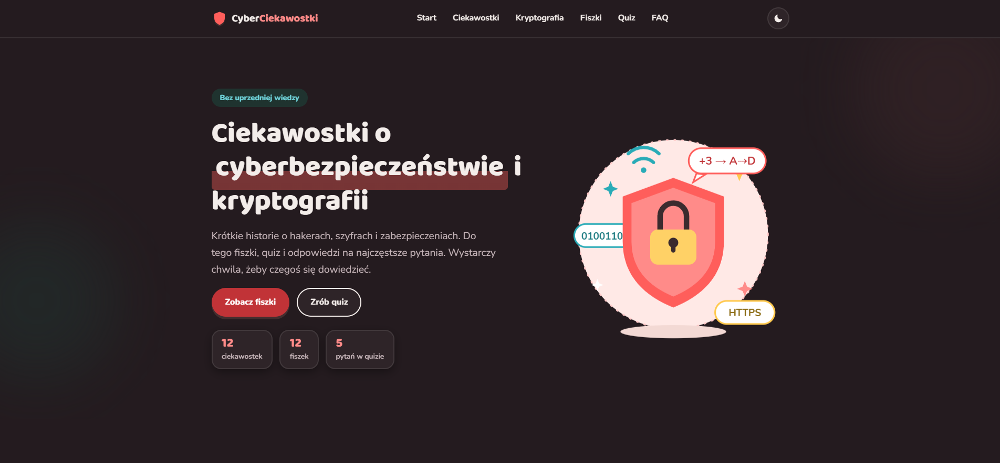

# CyberCiekawostki

  

Strona edukacyjna o cyberbezpieczeństwie i kryptografii. Zawiera krótkie historie i informacje o bezpieczeństwie w internecie, oraz praktyczne materiały do nauki.

## Zawartość strony
- **Ciekawostki** - 8 krótkich wpisów o atakach, phishingu, hasłach i bezpieczeństwie w sieci
- **Kryptografia** - 4 karty z historią szyfrów i ważnych momentów w rozwoju kryptografii
- **Fiszki** - 12 losowanych fiszek z pytaniami i odpowiedziami
- **Quiz** - 5 pytań z końcowym wynikiem
- **FAQ** - najczęstsze pytania początkujących o HTTPS, hasłach, 2FA i sieci Wi‑Fi

## Wykorzystane technologie
- HTML5 - struktura treści i sekcje strony
- CSS3 - responsywny układ, motyw jasny/ciemny i stylizacja elementów
- JavaScript - fiszki, quiz, losowanie pytań i interaktywne elementy
- SVG - ilustracje i ikony w nagłówku oraz sekcjach
